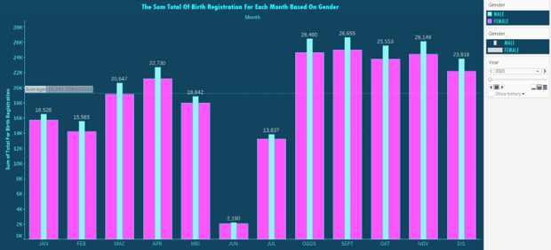
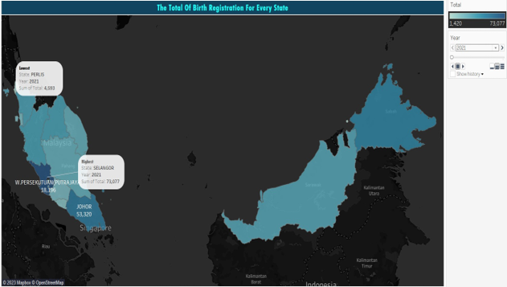
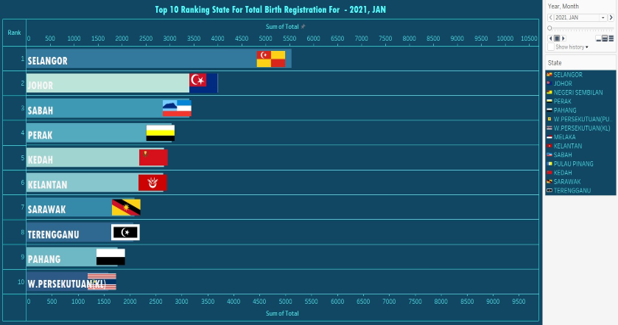
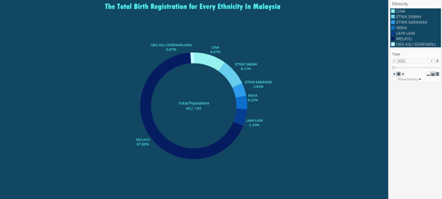

# Malaysia Birth Registration Analysis (2021-2022)

## 📌 Project Background
This project focuses on **Data Storytelling and Visualization** using **Tableau**. Using official birth registration data from Malaysia (2021-2022), I analyzed population trends across genders, states, and ethnicities. The goal was to translate raw demographic data into meaningful insights that are easy for stakeholders to understand.

## 📊 Key Insights & Analysis

### 1. Birth Registration by Gender

**Analysis:** In every month, male births consistently outnumbered female births, indicating a larger male population. September recorded the highest number of registrations for both genders, while June had the lowest (2,190 males and 2,058 females). This visualization makes it easy for policymakers to clearly see the monthly gender trends.

### 2. Total Birth Registration by State (Map)

**Analysis:** The map uses a color gradient where light blue indicates low registration and dark navy blue indicates high registration. Perlis had the lowest total (4,593) in 2021, which correlates with it being the smallest state in Malaysia. Conversely, Selangor had the highest (73,077). This proves that a small geographical size does not necessarily mean low birth registration, and vice versa.

### 3. Top 10 Ranking States

**Analysis:** Using a Running Bar Chart, I tracked the top 10 states for birth registration across 2021 and 2022. In January 2021, Selangor led with over 5,500 registrations, followed by Johor and Sabah. The bottom three states were Wilayah Persekutuan, Pahang, and Terengganu. This chart format makes it instantly clear which state is leading on any given date.

### 4. Ethnicity Breakdown

**Analysis:** The donut chart visualizes Malaysia's rich diversity. The Malay population is the largest (67.83%), followed by Chinese (9.87%), Sabah Ethnic groups (8.17%), and Indian (4.12%). Orang Asli Semenanjung represents the smallest percentage. This chart clearly highlights the unique multicultural composition of Malaysia.

## 💡 Conclusion
Birth registration is crucial for individual rights and national development. It provides legal recognition, identity, and access to essential services. By analyzing these demographic trends, we can predict future birth registration rates, improve resource allocation, and safeguard the well-being of Malaysian citizens.

## 🛠️ Tech Stack
- **Tableau** (Data Visualization & Storytelling)
- **Data Analysis** (Insight generation)

---
*Developed by Faiznajmi Bin Abd Rauf*
